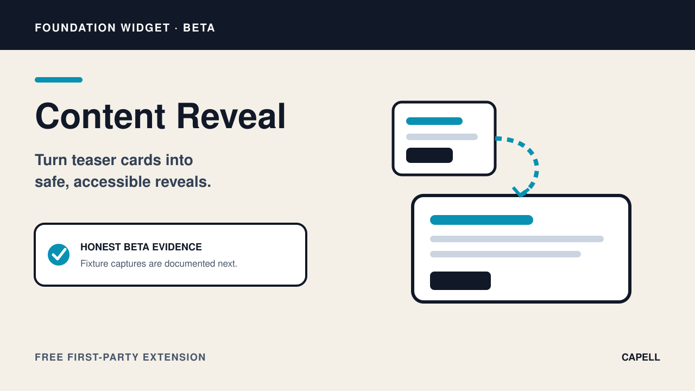
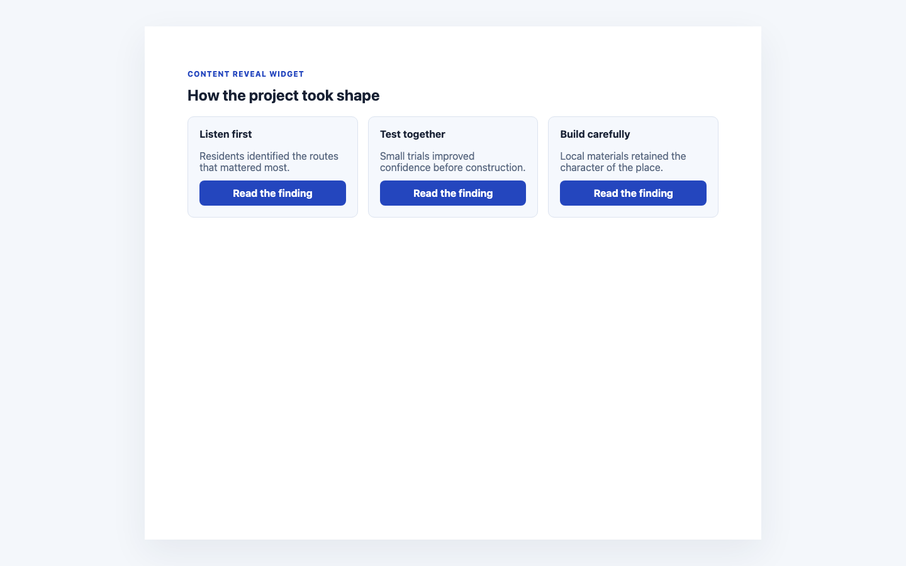

# Content Reveal Widget

<!-- prettier-ignore-start -->

## What This Plugin Adds

Content Reveal Widget is an **Available**, **No schema impact** Capell package in the **Capell Foundation** product group. It ships as `capell-app/widget-content-reveal` and extends these surfaces: admin, frontend.

Content Reveal adds a Layout Builder widget that presents teaser cards and reveals registered widget snapshots in modal, slideover, inline, or replacement modes. Reveal targets stay within the widget registry.

Editors connect a teaser to another registered widget, and visitors can reveal that content without leaving the current public page.

Status details:

- Status: Available
- Tier: free
- Bundle: foundation
- Composer package: `capell-app/widget-content-reveal`
- Namespace: `Capell\WidgetContentReveal`
- Theme key: not applicable

## Why It Matters

**For developers:** The extension declares interaction support and a widget target capability through a typed definition rather than accepting arbitrary render targets.

**For teams:** Teams can keep supporting material available on demand while preserving a concise first view of the page.

## Screens And Workflow

Screenshot contract: `docs/screenshots.json`.

- Content Reveal Widget extension card (marketplace, required evidence).
- Content Reveal fields in Layout Builder (admin, supplementary evidence).
- Content Reveal public output (frontend, required evidence).
- Content Reveal fields in Layout Builder with admin sidebar menu open (admin, supplementary evidence).

## Technical Shape

### Service providers

- `Capell\WidgetContentReveal\Providers\WidgetContentRevealServiceProvider`

### Filament classes

- `ContentRevealWidget`

### Data objects

- `ContentRevealInputData`
- `ContentRevealRenderData`
- `RevealCardData`

### Manifest contributions

- `content-widget: Capell\WidgetContentReveal\WidgetContentRevealContribution`

### Health checks

- `Capell\WidgetContentReveal\Health\WidgetContentRevealHealthCheck`

### Blade views

- `packages/widget-content-reveal/resources/views/widget.blade.php`

### Cache tags

- `widget-content-reveal`

## Data Model

This package has no schema impact. It extends Capell through `content-widget` contributions instead of declaring package-owned tables.

## Install Impact

- Required packages: `capell-app/admin`, `capell-app/core`, `capell-app/frontend`, `capell-app/layout-builder`.
- Admin navigation: no admin page or resource contribution is declared.
- Admin/editor extensions: `content-widget: WidgetContentRevealContribution`.
- Permissions: no package permission declarations or Shield gates detected; host access rules still apply.
- Public routes: none declared.
- Database changes: no package migrations declared.
- Config: no package config files.
- Settings: no package settings declared.
- Queues or schedules: none declared.
- Cache tags: `widget-content-reveal`.
- Commands: none declared.

## Common Pitfalls

- Keep required Capell packages on compatible v4 releases: `capell-app/admin`, `capell-app/core`, `capell-app/frontend`, `capell-app/layout-builder`.
- Keep public Blade and cached HTML free of authoring markers, model IDs, permissions, signed editor URLs, and lazy database queries.
- Custom write integrations must preserve invalidation for `widget-content-reveal` cache tags.

## Troubleshooting

| Symptom | Likely cause | Check | Fix |
| --- | --- | --- | --- |
| Package surface is missing after install | Provider or manifest is not loaded | Confirm `capell.json`, package `composer.json`, and provider registration | Reinstall the package, refresh Composer autoload, and clear host caches |
| Public output leaks unexpected state | Render data, cache variation, or authoring boundary has regressed | Check public Blade, cache tags, and public-output safety tests | Move data loading out of Blade and rerun the package public-output tests |

## Quick Start

1. Install the package: `composer require capell-app/widget-content-reveal`.
2. Open the package detail or install-intent surface and confirm the Content Reveal Widget extension card is present.

## Next Steps

- [Package docs](docs/README.md)
- [Overview](docs/overview.md)
- [Troubleshooting](#troubleshooting)
- [Screenshot contract](docs/screenshots.json)
- [Marketplace assets](docs/assets/marketplace/)
- [Capell content language plan](../../docs/CONTENT_LANGUAGE_PLAN.md)
- [Capell documentation design system](../../docs/DESIGN_SYSTEM.md)
- [Capell and package ERD notes](../../docs/erd/capell-and-package-erds.md)
- Related packages: [Layout Builder](../layout-builder/README.md).

<!-- prettier-ignore-end -->
