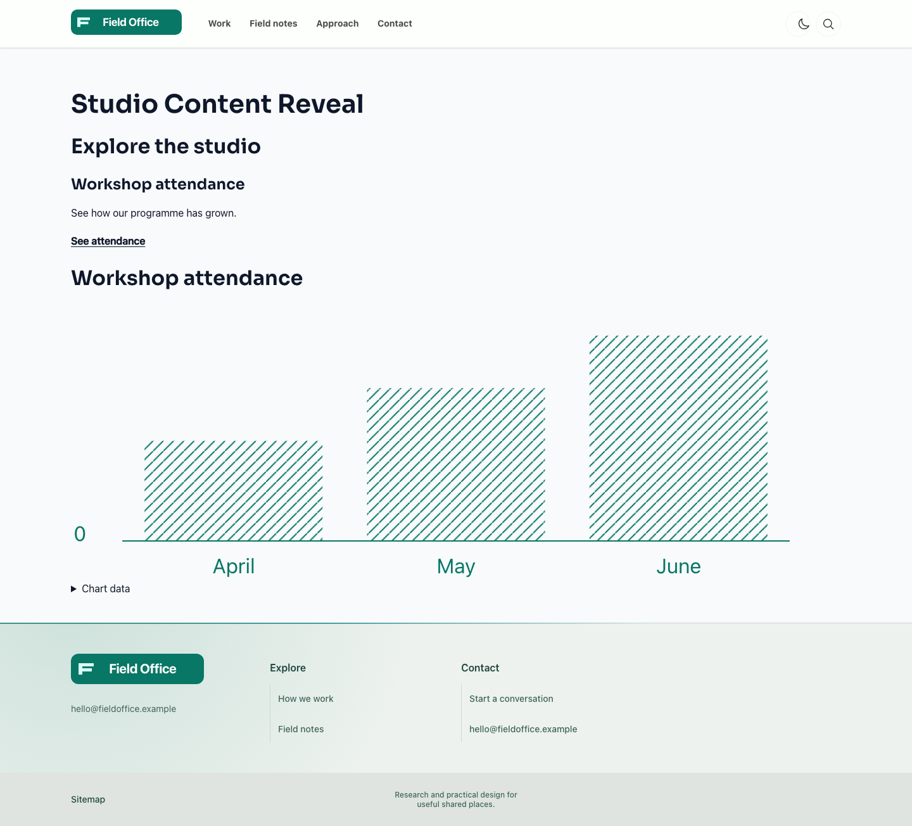
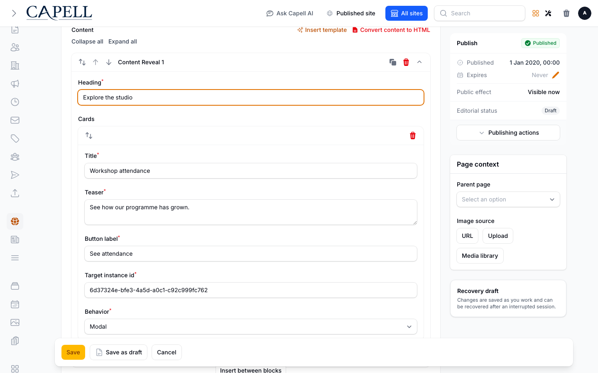

# Content Reveal Widget

<!-- prettier-ignore-start -->

A visitor presses "See prices" on a short card, and your price list opens over the page in a pop-up or a panel that slides in from the side. They read it, close it and are back where they were. That helps on a long page, where the part someone came for can be a lot of scrolling away.

The cards don't hold the detail themselves. Each one points at something you've already put on the same page, such as your price list or the piece about your team. Build that part of the page first and save it. Then add up to twelve cards, each with a title and a line of teaser text above its button.

For every card you pick what it opens from a searchable list of the other parts of that page. You also choose whether it appears as a pop-up or slides in from the side. A card can't open anything from a different page. Rearrange the page later and every card still opens the right part.

- **Price and availability:** Check current availability and price on the [Capell Marketplace listing](https://capell.app/marketplace/extensions/widget-content-reveal).
- **Licence:** Check the licence terms on the [Capell Marketplace listing](https://capell.app/marketplace/extensions/widget-content-reveal).
- **Requires:** `PHP ^8.4`, `capell-app/admin ^1.0`, `capell-app/core ^1.0.79`, `capell-app/frontend ^1.0.79`, `capell-app/layout-builder ^1.0`, `spatie/laravel-package-tools ^1.0`.
- **Install:** `composer require capell-app/widget-content-reveal:@beta`.

## Quick Start

1. Install the package: `composer require capell-app/widget-content-reveal:@beta`.
2. Open a page, click **Layout builder**, **Add widgets**, then choose **Content Reveal**.

## For Developers

The extension declares interaction support and a widget target capability through a typed definition rather than accepting arbitrary render targets.

## Configure

This extension works without configuration. There is nothing to set after install.

## Limits And Pitfalls

- Install the required Capell packages at the versions in `composer.json`: `capell-app/admin ^1.0`, `capell-app/core ^1.0.79`, `capell-app/frontend ^1.0.79`, `capell-app/layout-builder ^1.0`.
- Keep public Blade and cached HTML free of authoring markers, model IDs, permissions, signed editor URLs, and lazy database queries.
- Custom write integrations must preserve invalidation for `widget-content-reveal` cache tags.

## Screens And Workflow

- Content Reveal Widget extension card (marketplace).
- Content Reveal fields in Layout Builder (admin).
- Content Reveal public output (frontend).
- Content Reveal fields in Layout Builder with admin sidebar menu open (admin).

## Install Impact

- Required packages: `capell-app/admin`, `capell-app/core`, `capell-app/frontend`, `capell-app/layout-builder`.
- Admin navigation: no admin page or resource contribution is declared.
- Admin/editor extensions: `content-widget: WidgetContentRevealContribution`.
- Permissions: no package permission declarations or Shield gates detected; host access rules still apply.
- Public routes: none declared.
- Database changes: no package migrations declared.
- Config: no package config files.
- Settings: no package settings declared.
- Queues or schedules: none declared.
- Cache tags: `widget-content-reveal`.
- Commands: none declared.

## Troubleshooting

| Symptom | Likely cause | Check | Fix |
| --- | --- | --- | --- |
| Package surface is missing after install | Provider or manifest is not loaded | Confirm `capell.json`, package `composer.json`, and provider registration | Reinstall the package, refresh Composer autoload, and clear host caches |
| Public output leaks unexpected state | Render data, cache variation, or authoring boundary has regressed | Check public Blade, cache tags, and public-output safety tests | Move data loading out of Blade and rerun the package public-output tests |

## Upgrading

No manual steps between minor versions.

## Next Steps

- [Package docs](docs/README.md)
- [Overview](docs/overview.md)
- [Troubleshooting](#troubleshooting)
- [Developer reference](docs/reference.md)
- [Marketplace assets](docs/assets/marketplace/)
- [Capell content language plan](../../docs/CONTENT_LANGUAGE_PLAN.md)
- [Capell documentation design system](../../docs/DESIGN_SYSTEM.md)
- [Capell and package ERD notes](../../docs/erd/capell-and-package-erds.md)
- Related packages: [Layout Builder](../layout-builder/README.md).

<!-- prettier-ignore-end -->
